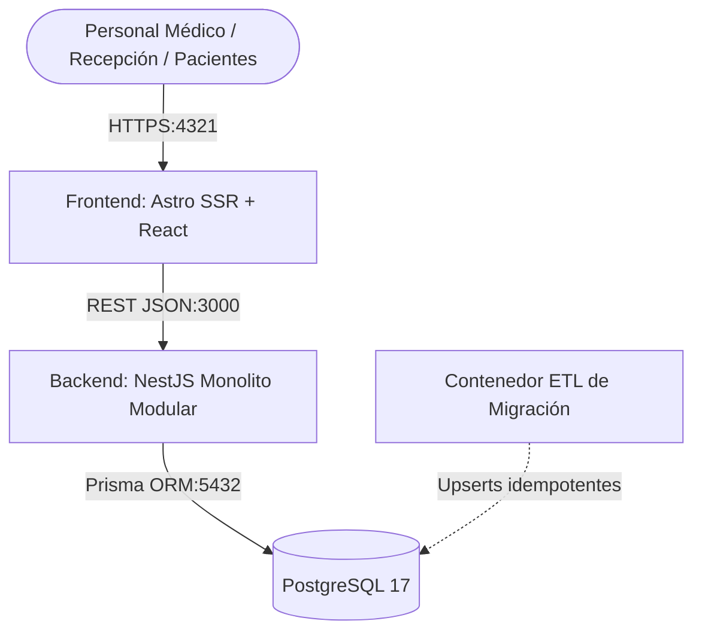

# Plataforma Clínica Horizonte — Stack Tecnológico Completo

> Sistema de Información Sanitaria y Gestión Ambulatoria para Clínica Horizonte (~180 pacientes diarios).
> Diseñado bajo una arquitectura de **Monolito Modular** desacoplado, alta disponibilidad, validación transaccional estricta sin solapamientos, RBAC, auditoría inmutable y OpenAPI 3.x.

---

## 1. Arquitectura del Sistema



### Contenedores y Servicios Mínimos
| Servicio | Tecnología | Puerto | Propósito |
|---|---|---|---|
| **frontend** | Astro SSR (Node standalone) + React + Tailwind | `4321` | Interfaz clínica, portal recepción, caja y médico |
| **backend** | NestJS + TypeScript + Prisma ORM | `3000` | Reglas de negocio, RBAC, prevención solapamiento, OpenAPI |
| **database** | PostgreSQL 17 Alpine | `5432` | Persistencia relacional, extensiones `uuid-ossp`, `pgcrypto` |
| **migration** | Node.js ETL script | Perfil `migration` | Migración de datos históricos sanitizados |

---

## 2. Estructura del Repositorio

```text
Arquitectura-Clinica-Horizonte/
├── clinica-horizonte-api/         # Backend: NestJS REST API Versionada (/api/v1)
│   ├── src/
│   │   ├── auth/                 # Autenticación JWT, hash contraseñas, RBAC
│   │   ├── users/                # Entidad y repositorio de usuarios
│   │   ├── patients/             # CRUD pacientes, búsqueda, paginación
│   │   ├── professionals/        # Profesionales, cálculo de disponibilidad
│   │   ├── specialties/          # Especialidades médicas y duraciones
│   │   ├── appointments/         # Prevención estricta de solapamiento
│   │   ├── payments/             # Pagos, bonos FONASA/ISAPRE, reembolsos
│   │   ├── clinical-care/        # Ficha clínica, CIE-10, recetas transaccionales
│   │   ├── audit/                # Auditoría inmutable y sanitización
│   │   ├── health/               # Endpoint de salud y diagnóstico (/api/v1/health)
│   │   ├── common/               # Guards, interceptores, filtros globales
│   │   └── prisma/               # Servicio y cliente de base de datos
│   ├── prisma/
│   │   ├── schema.prisma         # 14 entidades y relaciones normalizadas
│   │   └── seed.ts               # Semillas sintéticas realistas
│   ├── scripts/
│   │   └── export-openapi.ts     # Generador automático de contrato OpenAPI
│   ├── Dockerfile
│   └── package.json
├── clinica-horizonte-app/         # Frontend: Astro SSR + React SPA
│   ├── src/
│   │   ├── components/           # Formularios, agendas y paneles interactivos
│   │   ├── layouts/              # Plantilla base y navegación
│   │   ├── pages/                # Rutas: Dashboard, Agenda, Pacientes, Ficha, Caja, Auditoría
│   │   └── services/api.ts       # Cliente tipado contra /api/v1
│   ├── Dockerfile
│   └── package.json
├── database/
│   └── init.sql                  # Script DDL inicial de PostgreSQL
├── migration/                     # Contenedor temporal de migración ETL
│   ├── src/index.ts              # Pipeline: Extract -> Profile -> Map -> Transform -> Import
│   ├── Dockerfile
│   └── README.md
├── Docs/
│   ├── decisions/                # ADRs de Arquitectura, Modelo e Integridad
│   ├── api/                      # openapi.json generado y versionado
│   └── PLAN_TRABAJO_CLINICA_HORIZONTE.md
├── docker-compose.yml             # Orquestación de servicios locales y producción
├── .env.example                   # Variables de entorno documentadas
└── package.json                   # Scripts del monorepo
```

---

## 3. Modelo de Datos e Integridad

Implementado en `clinica-horizonte-api/prisma/schema.prisma` con las 14 entidades estipuladas:

- **Seguridad**: `User`, `Role`, `UserRole`, `AuditEvent`
- **Atención y Pacientes**: `Patient`, `Professional`, `Specialty`, `ProfessionalSpecialty`, `ProfessionalSchedule`
- **Operaciones**: `Appointment`, `Payment`
- **Área Clínica**: `ClinicalCare`, `Diagnosis`, `Treatment`

### Regla Crítica: Prevención de Solapamiento
El agendamiento médico rechaza cualquier intento de reserva concurrente para un mismo facultativo con el error de negocio:
```json
{
  "statusCode": 409,
  "code": "APPOINTMENT_OVERLAP",
  "message": "El profesional ya tiene una cita en ese intervalo.",
  "details": [{ "conflictingAppointmentId": "uuid", "start": "...", "end": "..." }],
  "traceId": "uuid"
}
```

---

## 4. Usuarios y Credenciales Sintéticas de Prueba

| Rol | Correo Electrónico | Contraseña | Capacidades |
|---|---|---|---|
| **ADMIN** | `admin@clinicahorizonte.cl` | `Clinica2026!` | Control total, usuarios y auditoría |
| **RECEPTIONIST** | `recepcion@clinicahorizonte.cl` | `Clinica2026!` | Agendamiento, disponibilidad y caja |
| **DOCTOR** | `dr.morales@clinicahorizonte.cl` | `Clinica2026!` | Ficha clínica, diagnóstico CIE-10 y recetas |
| **DOCTOR** | `dra.valenzuela@clinicahorizonte.cl` | `Clinica2026!` | Pediatría y medicina preventiva |
| **EXTERNAL_SUPPORT** | `soporte.ext@clinicahorizonte.cl` | `Clinica2026!` | Métricas técnicas y auditoría sanitizada |

---

## 5. Instrucciones de Ejecución

### Opción A: Con Docker Compose (Recomendado)
```bash
# 1. Configurar variables de entorno
cp .env.example .env

# 2. Construir y levantar servicios
docker compose up -d

# 3. Comprobar estado de los servicios
docker compose ps
```
- Frontend: `http://localhost:4321`
- Backend API: `http://localhost:3000/api/v1`
- Swagger UI: `http://localhost:3000/api/docs`
- OpenAPI JSON: `http://localhost:3000/api/docs-json`

### Opción B: Ejecución Local Nativa (Node.js & npm)

```bash
# 1. Instalar dependencias en Backend
cd clinica-horizonte-api
npm install
npx prisma generate
npm run build

# 2. Ejecutar Pruebas Unitarias
npm test

# 3. Iniciar Backend
npm run start:dev

# 4. En otra terminal, iniciar Frontend
cd ../clinica-horizonte-app
npm install
npm run dev
```

---

## 6. Verificación y Definition of Done (DoD)

- [x] Arquitectura de Monolito Modular desacoplada según especificación de Docs.
- [x] Backend NestJS con prefijo `/api` y versionado `/api/v1`.
- [x] Documentación interactiva Swagger UI en `/api/docs` y exportación a `Docs/api/openapi.json`.
- [x] DTOs fuertemente tipados con validación `class-validator` y filtro de excepción uniforme `{ statusCode, code, message, details, traceId }`.
- [x] Modelo de datos completo en Prisma con 14 entidades relacionales y PostgreSQL.
- [x] Algoritmo de cálculo de disponibilidad y rechazo de solapamientos (`APPOINTMENT_OVERLAP`).
- [x] Registro de pagos con exigencia de bono en FONASA/ISAPRE e inmutabilidad en anulaciones.
- [x] Ficha clínica con registro transaccional de atención, examen, diagnósticos CIE-10 y tratamientos.
- [x] Auditoría inmutable de eventos sensibles con sanitización de contraseñas y tokens.
- [x] Frontend Astro SSR con componentes interactivos React y diseño Tailwind CSS responsive.
- [x] Dockerfiles multi-stage y `docker-compose.yml` completo con dependencias y health checks.
- [x] Script de migración ETL idempotente en `migration/`.
- [x] Pruebas unitarias de prevención de solapamientos y pagos aprobadas al 100%.
